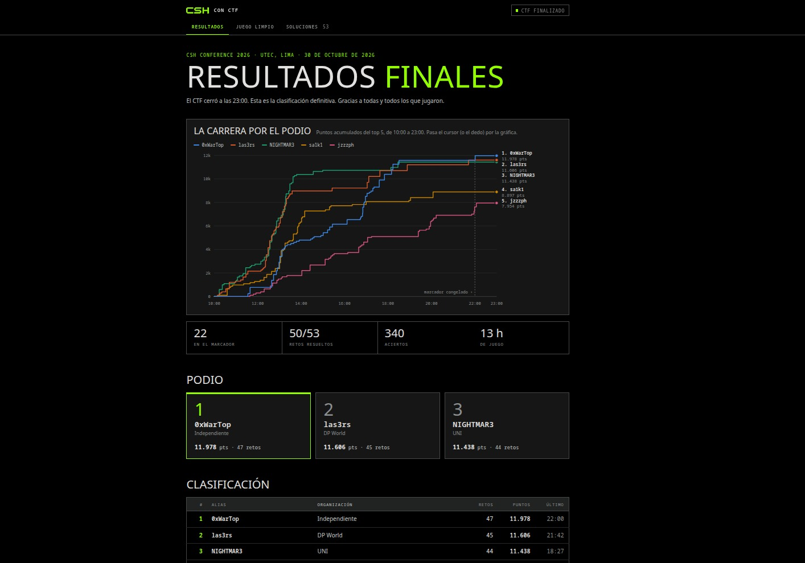

# CSH CON CTF 2026 · Lo que aprendí resolviendo retos

**Jhon Paul Mejia Quispe · NIGHTMAR3 · Universidad Nacional de Ingeniería**

El 30 de octubre participé en el CTF de CSH CON, organizado por Cyber Security Hub de UTEC. Terminé en **tercer lugar, con 44 retos y 11 438 puntos**.

Quise dejar algo más útil que una lista de flags. Este repositorio reúne una selección de los retos para los que pude recuperar comandos, capturas, código o resultados: cómo reconocí el problema, qué pruebas ayudaron a entenderlo y qué detalles hicieron funcionar la solución. También recojo los intentos que quedaron a medias, porque revisar por qué fallaron forma parte del aprendizaje.



## Por dónde empezar

| Si te interesa… | Lectura recomendada | Lo que se trabaja |
|---|---|---|
| Seguridad web | [Pachamama, Mallku y Amaru](writeups/01-web.md) | Inyección NoSQL, SQLi booleana y exposición de tokens |
| Análisis de código web | [Ayni, Kuska, Void y Yaku](writeups/02-codigo-web.md) | Asignación masiva, firmas opcionales y autorización |
| Explotación de binarios | [Inti Vault, Apu y Wiracocha](writeups/03-pwn.md) | Convención de llamadas, format strings, GOT y ret2libc |
| Depuración de un exploit | [Chavín](writeups/04-chavin.md) | Carreras, use-after-free, safe-linking y diferencias entre entornos |
| Administración de Linux | [Kotosh, Pachacámac, Ollanta y Pisac](writeups/05-linux.md) | Logs, servicios, configuración y tareas programadas |
| Reversing y codificación | [Inti Glyph y Chasqui Relay](writeups/06-reversing-y-codificacion.md) | XOR, lectura de un ELF y corrección Hamming (7,4) |
| Criptografía | [Kuélap](writeups/07-kuelap.md) | Meet in the middle y verificación AES-GCM |

Son **14 reconstrucciones de soluciones y 4 análisis adicionales de código web**. Esta selección no equivale a documentar los 44 retos del marcador. Los temas de la tabla describen el contenido técnico; no pretenden sustituir las categorías oficiales.

## Qué demuestra este trabajo

- **Razonamiento a partir de respuestas:** convertir errores SQL, diferencias de autenticación o una lista vacía en pruebas concretas.
- **Lectura de código y ensamblador:** seguir cómo llega una entrada a una consulta, una variable de rol o una dirección de retorno.
- **Automatización:** escribir oráculos de extracción y decodificadores que evitan repetir tareas a mano.
- **Depuración:** distinguir un problema de parseo, de sincronización, de alineación o de offsets antes de cambiar todo el exploit.
- **Documentación técnica:** explicar tanto el resultado como la evidencia que lo sostiene.

## Scripts y reproducción

Los [scripts](scripts/README.md) incluyen los exploits recuperados de la sesión y tres decodificadores preparados para esta publicación. Chasqui, Inti Glyph y Kuélap se volvieron a comprobar con los datos disponibles; no necesitan conectarse a una instancia.

```bash
python3 -m venv .venv
source .venv/bin/activate
pip install -r requirements.txt
python3 scripts/chasqui_decode.py
python3 scripts/inti_glyph_decode.py
python3 scripts/kuelap_solve.py
```

Los exploits remotos dependen del binario y del entorno originales. El detalle de qué se verificó está en [reproducción y evidencias](docs/VERIFICACION.md).

## Sobre esta reconstrucción

El texto está escrito después de la competencia a partir de mis notas, capturas, archivos y conversaciones de trabajo con ChatGPT/Codex y Claude. La explicación y las comprobaciones se organizaron con asistencia de estas herramientas. Las salidas de terminal citadas proceden de los registros o de las verificaciones locales indicadas. Las capturas muestran obtención de flags; salvo el resultado global del marcador, no conservo una pantalla de aceptación para cada una.

Las imágenes se conservan a su resolución original y se pueden abrir para leer el texto completo. Los materiales del reto incluidos como datos de ejemplo mantienen su atribución a CSH CON CTF 2026.

También dejé [notas de los retos pendientes](docs/NOTAS-PENDIENTES.md) y un [texto para compartir el proyecto en LinkedIn](docs/LINKEDIN.md).

**Evento:** [CSH CON CTF 2026](https://conf.csh.org.pe/ctf) · **Perfil:** [Nightdxs](https://github.com/Nightdxs)
