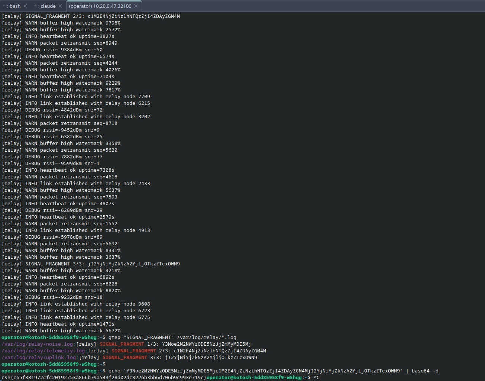
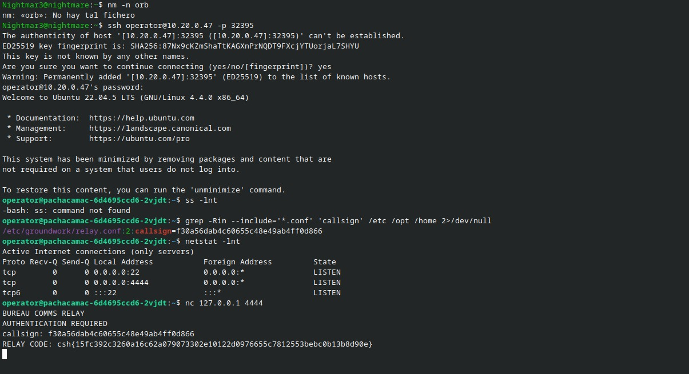
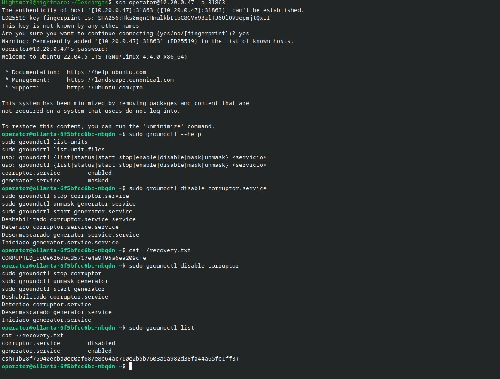
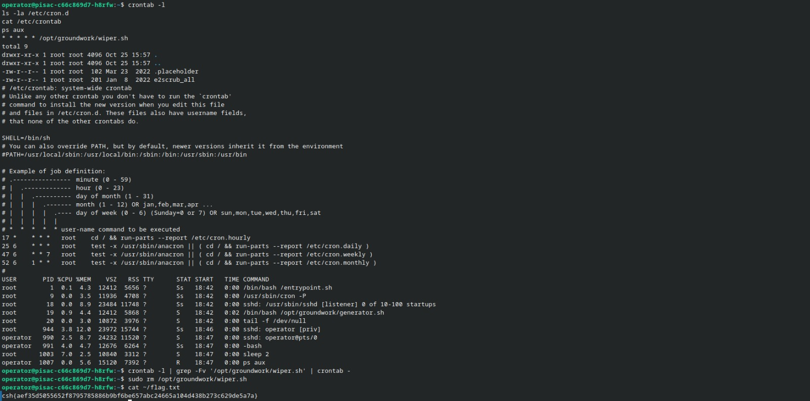

# Linux: leer el entorno antes de cambiarlo

[← Volver al índice](../README.md)

Estos retos tuvieron algo en común: la información necesaria estaba en el propio sistema. Revisar logs, archivos de configuración, puertos y tareas programadas permitió avanzar sin buscar una vulnerabilidad compleja. Los nombres de esta página corresponden a los hosts visibles en las capturas; no he recuperado todos los títulos completos de las fichas originales.

## Kotosh: tres fragmentos entre mucho ruido

La terminal mostraba mensajes de retransmisiones, señal y buffers. Entre ellos aparecía una marca bastante distinta: `SIGNAL_FRAGMENT`. En lugar de leer todo el flujo, filtré esa etiqueta en los archivos del relay:

```bash
grep 'SIGNAL_FRAGMENT' /var/log/relay/*.log
```

Los tres resultados estaban repartidos entre `noise.log`, `telemetry.log` y `uplink.log`, identificados como `1/3`, `2/3` y `3/3`. No había que ordenarlos por el nombre del archivo, sino por el número del fragmento.

```bash
printf '%s' '<fragmento-1><fragmento-2><fragmento-3>' | base64 -d
```

La salida guardada fue:

```text
csh{c65f381972cfc20192753a866b79a543f28d02dc8226b3bb6d706b9c993e719c}
```



Concatenar antes de decodificar evita asumir que cada fragmento sea un bloque Base64 independiente. Lo que parecía una pantalla llena de ruido se redujo a una búsqueda por marca y una reconstrucción por orden.

## Pachacámac: el servicio también estaba dentro

La captura empieza con una sesión SSH como `operator`. No conservo en ella la obtención de la contraseña inicial, así que la reconstrucción comienza desde ese acceso.

Una búsqueda en archivos de configuración encontró el `callsign` en `/etc/groundwork/relay.conf`:

```bash
grep -Rin --include='*.conf' 'callsign' /etc /opt /home 2>/dev/null
```

Después intenté listar puertos con `ss`, pero no estaba instalado. La alternativa disponible fue:

```bash
netstat -lnt
```

Entre los servicios aparecía el puerto 4444. Al conectarme desde la propia instancia se presentó `BUREAU COMMS RELAY` y pidió el callsign:

```bash
nc 127.0.0.1 4444
```

Introducir el valor del archivo de configuración devolvió:

```text
csh{15fc392c3260a16c62a079073302e10122d0976655c7812553bebc0b13b8d90e}
```



El aprendizaje fue ampliar la revisión más allá del puerto de entrada. Una sesión dentro del contenedor permite descubrir servicios y configuraciones que no se ven en la pantalla inicial del reto. En este caso, las dos piezas estaban juntas: el servicio y el dato que pedía para autenticarse.

## Ollanta: el sufijo que cambiaba el resultado

La instancia traía `groundctl`, una utilidad propia del laboratorio. La ayuda mostraba acciones para listar, iniciar, detener, habilitar y desenmascarar servicios. El estado inicial señalaba `corruptor.service` habilitado y `generator.service` enmascarado.

La primera secuencia añadió `.service` a los nombres. La herramienta respondió con nombres terminados en `.service.service` y `~/recovery.txt` seguía mostrando `CORRUPTED_...`. La salida era una pista de que la interfaz ya añadía el sufijo.

La segunda secuencia fue:

```bash
sudo groundctl disable corruptor
sudo groundctl stop corruptor
sudo groundctl unmask generator
sudo groundctl start generator
sudo groundctl list
cat ~/recovery.txt
```

El listado final mostraba `corruptor.service disabled` y `generator.service enabled`. El archivo contenía:

```text
csh{1b28f75940ecba0ec0af687e8e64ac710e2b5b7603a5a982d38fa44a65fe1ff3}
```



Aquí fue importante comprobar el efecto del comando, en vez de tomar un mensaje de «iniciado» como prueba suficiente. La captura no contiene el código de `groundctl`, pero sí muestra que corregir los nombres produjo el estado y el archivo esperados.

## Pisac: una tarea que volvía cada minuto

Antes de intentar recuperar el archivo, revisé qué se ejecutaba periódicamente:

```bash
crontab -l
ls -la /etc/cron.d
cat /etc/crontab
ps aux
```

En la crontab del usuario había esta línea:

```cron
* * * * * /opt/groundwork/wiper.sh
```

La captura también muestra un proceso `generator.sh`. El nombre del borrador y su ejecución cada minuto apuntaban a una tarea que podía interferir con la recuperación. La secuencia documentada retiró esa entrada y eliminó el script dentro de la instancia:

```bash
crontab -l | grep -Fv '/opt/groundwork/wiper.sh' | crontab -
sudo rm /opt/groundwork/wiper.sh
cat ~/flag.txt
```



La cadena transcrita de la captura es:

```text
csh{aef35d5055652f8795785886b9bf6be657abc24665a104d438b273c629de5a7a}
```

No recuperé el contenido de `wiper.sh`, así que no describo su implementación como si la hubiera inspeccionado. Lo comprobable es la tarea programada, los comandos usados y la lectura posterior de la flag. Este caso me recordó que un cambio puede durar poco si hay otro proceso que lo revierte: revisar la automatización del sistema forma parte del diagnóstico.
